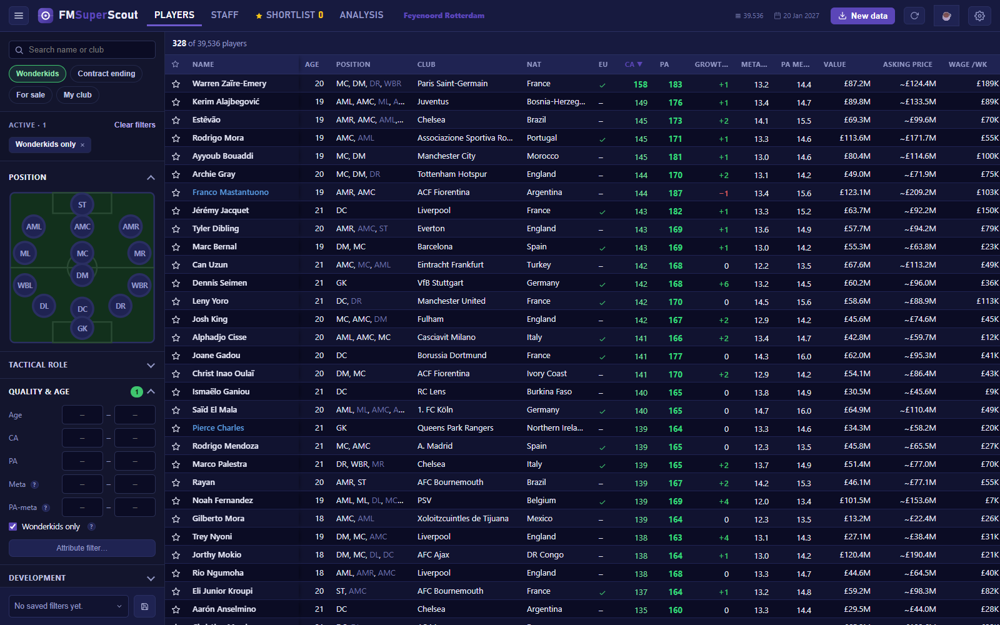
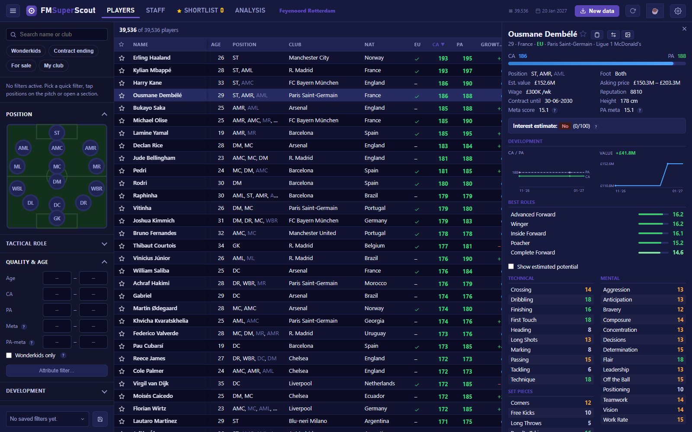
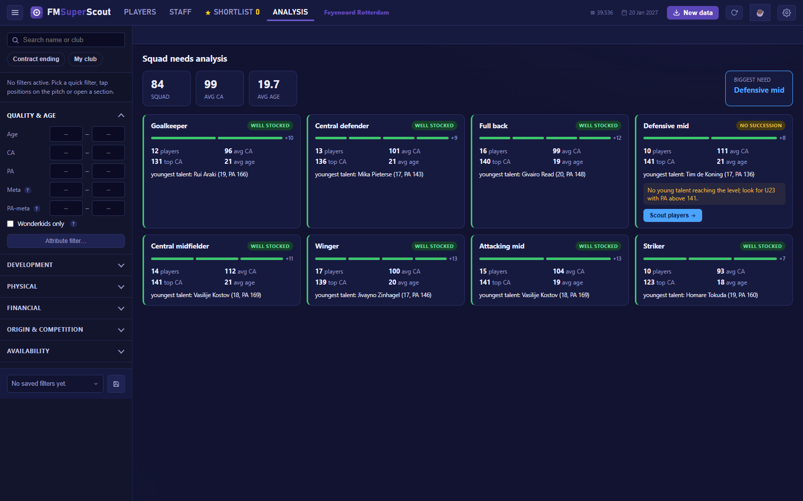

<p align="center">
  
</p>

<h1 align="center">FMSuperScout</h1>

<p align="center">A fast, open source scouting tool for <strong>Football Manager 27</strong> and <strong>26</strong> (Windows and Mac).</p>

<p align="center">
  <a href="https://github.com/mavarobli/FMSuperScout/releases/latest/download/FMSuperScout-Setup.exe"><strong>Download for Windows</strong></a>
  ·
  <a href="https://github.com/mavarobli/FMSuperScout/releases/latest/download/FMSuperScout-Mac.dmg"><strong>Download for Mac</strong></a>
  ·
  <a href="CHANGELOG.md">Changelog</a>
  ·
  <a href="TROUBLESHOOTING.md">Troubleshooting</a>
</p>

---

Press **F9** in your save (or click **New data**) and the full loaded database, 60,000+ players and staff, is pulled out
of memory in about 6 seconds. Including what FM normally hides: **CA and PA**, hidden personality
attributes and FM's **real transfer value**. After that everything is instant. Monster saves work
too: 635k people across 100+ leagues loads in about 17 seconds.

Two parts: a reader that pulls the database out of the game (on Windows a small scanner, on the
Mac a module that loads with FM), and a **local app** where you search, filter and compare.
Nothing goes into your game folder, no internet, no account, no ads, nothing leaves your machine.

> Single-player use only. The scanner **only reads** memory, it never writes to the game.

<p align="center">
  
</p>
<p align="center"><sub>One click on Wonderkids: 328 of 39,536 players, real CA/PA, growth since your last scans, value and wage.</sub></p>

## What it does that other tools do not

**It remembers.** Every time you press F9 the app stores a small snapshot. Nothing else reads your
save over time, and that unlocks two things no tool without memory can do:

- **Growth.** Pick a period (since your last dump, 6 months, a year, this season) and every player
  gets a number: how much CA he gained since then. Green up, red down. Sort the world by it, or
  filter on it. "Everyone who gained 10 or more CA in the last year" is one filter.
- **Intake Radar.** On youth intake day a bar tells you how many newgens appeared worldwide since
  your last dump and who the best one is. One click shows them all, sorted by potential. To a tool
  that only reads the present, a brand new 16-year-old with PA 178 looks like every other
  16-year-old.

**A meta score built on real testing.** Every player gets a 1-20 score weighted by
[FM-Arena's attribute testing](https://fm-arena.com/table/26-player-attributes-testing): what
actually wins matches in the engine. Two players with equal CA? The higher meta score usually
performs better. Goalkeepers get their own weighting, based on
[harvestgreen22's keeper attribute retest](https://fm-arena.com/thread/18816-fm24-i-re-tested-the-goalkeeper-s-attributes-using-newer-test-league/).
Next to it sits **PA meta**: the same weighting applied to the attributes a player is expected
to have at his potential, following the measured growth profile of his position group. Sort on
it to find tomorrow's meta stars.

**Shareable player cards.** One click saves a PNG in FM's own visual language: scout stars for
current and potential ability, the full attribute grid in FM colours, best roles and finances.
Wonderkids get a gold card. Built for showing off that one insane regen.

<p align="center">
  
</p>
<p align="center"><sub>A player profile: CA/PA, value and asking price, how ability and value moved across the save, best roles and every attribute.</sub></p>

<p align="center">
  
</p>
<p align="center"><sub>Squad analysis: depth, average CA and age per position, and where you have no successor coming through.</sub></p>

## Everything else

- **Filters that stack**: age, CA/PA, meta, value, asking price, wage, nationality, EU/EEA,
  contract, transfer status, division, height, foot, positions on a clickable pitch, and quick
  filters (wonderkids, contract ending, for sale, my club).
- **Attribute filter**: min/max on any attribute, hidden ones and personality included, for
  players and staff. Saved presets keep the whole setup under one name.
- **Staff search** like FM's: current role and preferred job side by side (free agents
  included), a role filter that also finds staff with a strong preference for the job, and a
  **suitability** score per role from the staff attributes.
- **Role ratings** for 19 FM roles, **comparison** of up to 3 players, **squad analysis** per
  position group, and **development charts** per player.
- **Your club** by squad: first team, reserves or youth, with loaned-out players under the
  squad they belong to. **Loans** shown with the parent club; **market value** from memory for most players, an
  estimate for the rest; **asking price and transfer interest** estimates.
- **Shortlist** with CSV export; **network saves**: pick which manager is you.
- **Settings**: English, Dutch, French, German; GBP/EUR/USD; one toggle hides CA/PA and all
  hidden stats if you consider them cheating.
- **Updates**: a daily check with a dismissible notice. On Windows one click downloads the
  installer, checks its SHA-256 and starts it.

## Install

### Windows

1. Download **[FMSuperScout-Setup.exe](https://github.com/mavarobli/FMSuperScout/releases/latest/download/FMSuperScout-Setup.exe)**
   (or pick a version from the [Releases](https://github.com/mavarobli/FMSuperScout/releases) page).
2. Windows SmartScreen may warn about an unknown publisher, since the installer isn't code-signed.
   Click **More info → Run anyway**. Want to verify first? Check the file's SHA-256 against the
   release notes: `Get-FileHash .\FMSuperScout-Setup.exe -Algorithm SHA256`.
3. Run it.
4. Start FM27 (or FM26) and load your save.
5. Open **FMSuperScout** from the Start menu and click **New data**, or press **F9** in the game.
   The data loads by itself when the scan is done. F9 keeps working while FM runs, also after you
   close the app.

To remove it: *Apps and features* → FMSuperScout. Coming from 1.5.0 or older? The old BepInEx
plugin is no longer needed; uninstalling removes the plugin DLL, BepInEx itself stays (other mods
may use it).

### Mac

FMSuperScout for Mac works with the **Steam version of FM27** on macOS 13 or newer, on Apple
Silicon and Intel Macs. It is new and has only been tested on one M1 Mac so far (Intel not at
all), so reports, good or bad, are very welcome.

1. Download **[FMSuperScout-Mac.dmg](https://github.com/mavarobli/FMSuperScout/releases/latest/download/FMSuperScout-Mac.dmg)**,
   open it and drag FMSuperScout to Applications.
2. Open FMSuperScout. The first time macOS says it cannot check the app, because it is not
   signed with an Apple developer certificate. Go to **System Settings → Privacy & Security**,
   scroll down and click **Open Anyway**, then confirm.
3. Make sure Steam is open and you are logged in.
4. Click **Start Football Manager** in the app, load your save and click **New data**.

On the Mac, Football Manager has to be **started from FMSuperScout** (not from Steam): macOS
only lets FMSuperScout read the game when it loads together with it. Started FM from Steam
anyway? The app tells you; save, quit FM and use the button. Once FM runs, you can close and
reopen FMSuperScout as often as you like. There is no F9 on the Mac; use **New data**.

To remove it: drag FMSuperScout from Applications to the Bin, and delete
`~/Library/Application Support/FMSuperScout` if you want your data gone too.

Your data lives in `%LOCALAPPDATA%\FMSuperScout\` (Windows) or
`~/Library/Application Support/FMSuperScout/` (Mac): the dumps, `diagnostics.txt` and a log.
Something not working? See [TROUBLESHOOTING.md](TROUBLESHOOTING.md), or use **Report a problem**
in the app's settings menu.

## Run from source (developers)

Requires [Node.js](https://nodejs.org) (any recent version; no dependencies to install).

```bash
node app/server.js       # then open http://localhost:8765
npm test                 # run the model tests (zero dependency, node:test)
```

Or double-click `Start FMSuperScout.cmd`. The scanner is C# (.NET 8) and shares its scan core
(`core/`) with the legacy FM26 BepInEx plugin (`plugin/`):

```bash
dotnet build scanner -c Release        # dev build, picked up by app/server.js automatically
dotnet publish scanner -c Release      # self-contained single exe -> scanner/dist/
scanner/dist/FMSuperScout.Scanner.exe scan   # one dump of the running fm.exe
```

To build the standalone installer yourself (requires the .NET 8 SDK and Inno Setup 6):

```powershell
powershell -ExecutionPolicy Bypass -File installer/build-exe.ps1
# -> dist/FMSuperScout-Setup.exe (+ .sha256)
```

A viewer-only zip package is also available via `installer/build-package.ps1`.

**Mac.** The Mac module (`mac/`, .NET NativeAOT) and the app (`mac/app`, Swift) can only be
built on a Mac. `bash mac/build.sh` builds the module from source and installs a test setup with
`FMSuperScout.command`; the `mac` GitHub workflow builds the complete `FMSuperScout-Mac.dmg`.
See [`mac/README.md`](mac/README.md).

## Accuracy

**Read straight from memory (reliable):** name, nationality, birth year, height, foot; **CA and
PA** (the real values); all visible and hidden attributes and positions; wage, contract end,
transfer status; current club; club and player reputation; **FM's real transfer value** for most
players; staff CA/PA, attributes, role, **preferred job**, reputation and personality.

**Estimates (clearly labelled as such):**

- **Market value fallback**: for the minority of players where FM does not store a value, a
  log-linear model calibrated on players with a real in-game value fills the gap (saturating
  reputation curve, age, and remaining contract length). Read values are shown exactly; estimates
  are shown as a range. Method: [`docs/value-model.md`](docs/value-model.md).
- **Asking price**: the read/estimated value adjusted by contract length, transfer status
  (listed, not-for-sale, release clause), age and potential, and club reputation.
- **Potential attributes**: projects each attribute toward the player's PA. Derived from how FM's
  Current Ability works (CA is a linear, weighted sum of the attributes, so scaling toward PA is
  the profile-preserving projection), then tilted by age and attribute type so physical attributes
  fade with age while mental and technical keep improving, and capped at 20.
- **Transfer interest**: a heuristic from reputation gap (your club vs theirs and vs the player's
  own stature), wage affordability, availability, personality, age, and FIFA Article 19.

None of the estimates are exact FM numbers, but each is built on FM's dominant factors and covered
by the model tests in [`test/`](test/).

## Project structure

| Path | Contents |
|---|---|
| `app/` | Local web app (Node, zero dependencies) |
| `core/` | Shared C# scan core: memory reader, dumper, per-version memory layouts |
| `scanner/` | Windows: external scanner (reads `fm.exe` from the outside; FM27 and FM26) |
| `mac/` | Mac: module that runs inside FM (NativeAOT), its loader, the Mac app (Swift) and build scripts |
| `plugin/` | Legacy FM26 BepInEx plugin host (same core; no longer shipped) |
| `installer/` | Windows installer (Inno Setup), icon generator, launcher, package builder |
| `test/` | Zero-dependency model tests (`npm test`) |
| `tools/` | Calibration scripts and the Mac measuring tools (`mac-diagnose.sh`, `mac-probe/`) |
| `docs/` | Value model, re-pin guide, Mac research, .fmf format, release notes and backlog |

## Where this fits

FM has a healthy set of tools that read hidden data from memory, several of them very good and
several of them free. If you want to *edit* your save, want deep match statistics with xG and
per-90s, or want an overlay inside the game itself, other tools do those things well and this one
does not.

Pick this one for the speed, the development tracking, and because it is open source: you can read
exactly what it does with your system.

## Support

FMSuperScout is free and stays free. If it saved you an hour of squinting at slow menus, you can
[buy me a coffee](https://ko-fi.com/fmsuperscout). If not, it keeps working anyway. ☕

## Disclaimer

Not affiliated with Sports Interactive or SEGA. For personal, single-player use. Football Manager
is a trademark of Sports Interactive.
